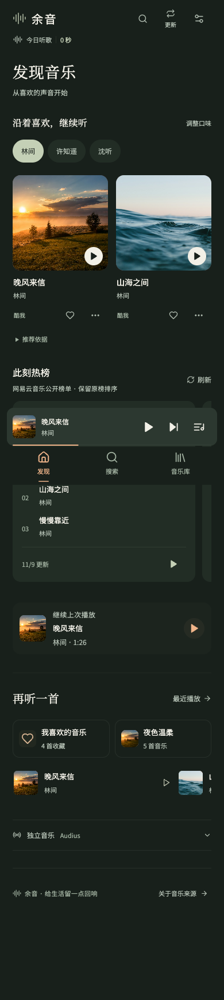
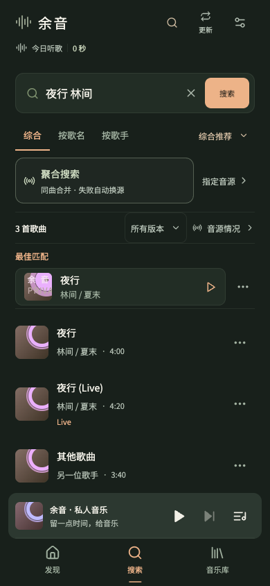
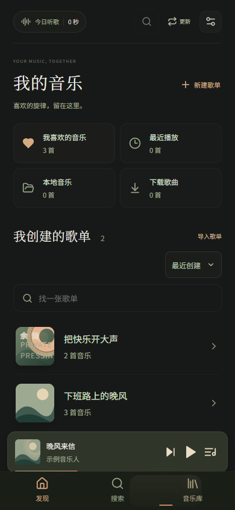
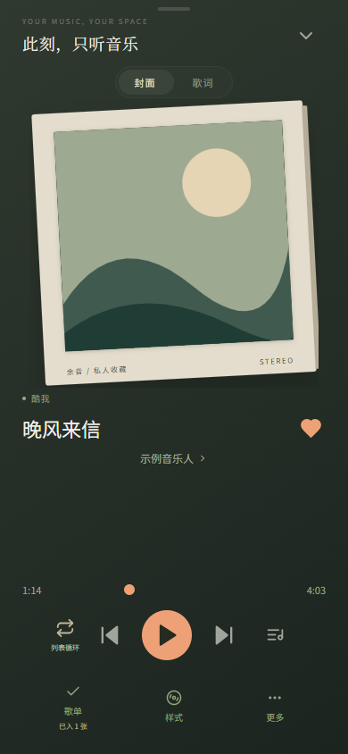
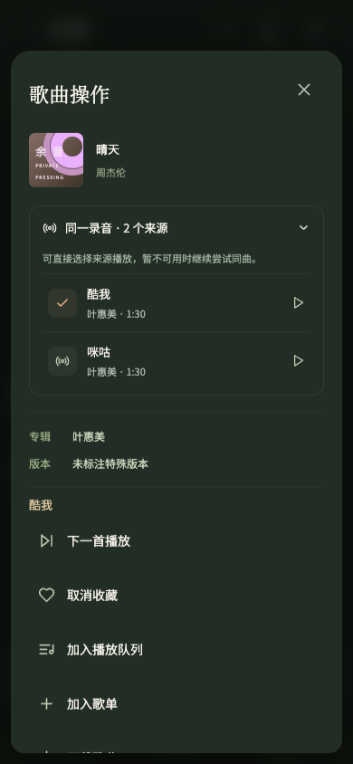
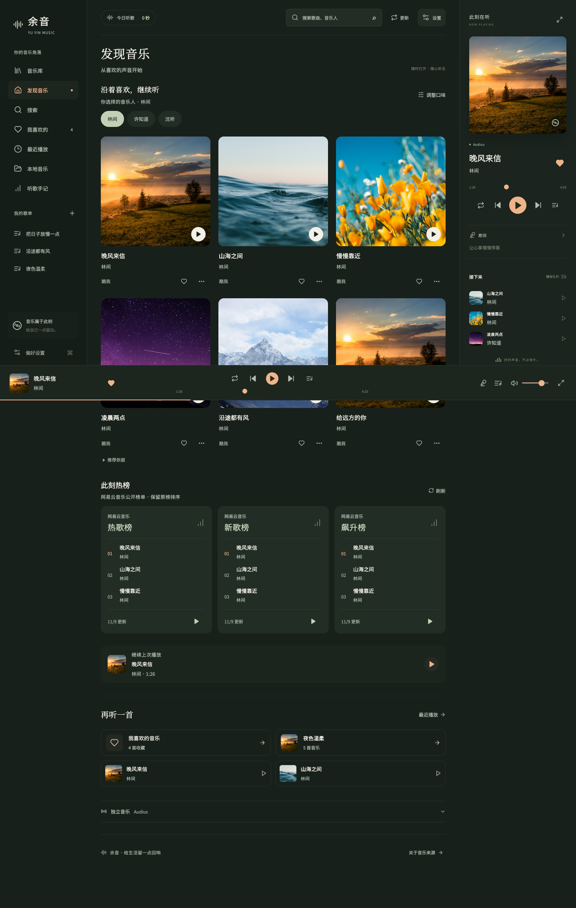

# 余音 · 私人音乐空间

给生活留一点回响。一个无广告的个人音乐 App，把发现、收藏、歌单和播放器放在安静的界面里。

**[下载最新 Android APK](https://github.com/junnhwan/yuyin-music/releases/latest)** · Android 7.0 及以上 · 在线音乐与本地播放

## 主要功能

- 「静谧唱片室」界面：深墨、鼠尾草绿与暖杏，精致的发现页、音乐库与完整播放器。
- 发现音乐：网易榜单、常听歌手推荐与 Audius 独立音乐。
- 默认聚合网易、酷狗、QQ、咪咕、酷我与 Audius 搜索；核对同一录音后合并重复项，失败时自动尝试其他来源，也可在歌曲面板直接选择同曲来源。
- 搜索提供独立最佳匹配与录音版本筛选，突出歌名和歌手同时匹配的结果，原列表保持稳定；保留综合推荐、相关度、近期榜单热度、失败音源单独重试、各源独立分页与搜索历史。热度参考网易飙升榜和热歌榜，标明更新日期。
- 减少起播前的额外等待，音质详情随播放补齐；换源时快候选先进入尝试。播放与下载分别选择音质，技术信息按需展开，听歌时少些打扰。
- 独立音乐库：收藏、最近播放、个人歌单和本地音频；歌单内默认最近添加在前，保留多种排序和原始顺序。
- Android 下载保存到 Music/余音，支持旧下载迁移与离线读取。
- 播放队列、「下一首播放」、调整顺序、随机与循环；恢复上次歌曲和进度，启动保持暂停。
- 原生后台与锁屏播放、系统媒体控制和睡眠定时。
- 播放时自动寻找歌词，临时失败安静重试，网络恢复和回前台自动继续；同曲自动换源保留歌词，支持同步跟随与手动导入。
- 日/月/年听歌手记、本机资料备份与恢复、应用内检查更新。

## 界面预览

截图使用「静谧唱片室」的实际 Web 界面与合成演示资料；Android 沿用相同页面。搜索展示 1.9 的最佳匹配与版本筛选，同曲来源选择保留 1.8 的面板，其他预览沿用同一主题。这些是演示截图，封面使用应用图形及 [Unsplash 许可照片](https://unsplash.com/license)，不代表真实歌曲或音源结果。

<table>
  <tr><th>发现音乐</th><th>搜索</th><th>我的音乐</th><th>播放器</th></tr>
  <tr>
    <td></td>
    <td></td>
    <td></td>
    <td></td>
  </tr>
</table>

同一录音可直接选择来源播放；失败后继续尝试已核对的同曲候选。

## 安装与更新

从 Releases 下载正式 `.apk`，通过 Android 安装面板安装。应用设置支持检查更新、下载与校验，再交给系统安装。

后续正式版沿用相同包名和签名，直接覆盖安装，**不要先卸载**。升级前建议导出资料备份。此前 Debug 测试包与正式版签名不同，迁移前先备份。包名固定为 `cn.yuyin.music`。

## 音乐来源与本地资料

使用网易 · [GD音乐台](https://music.gdstudio.xyz)、酷我、咪咕与 Audius 等来源，部分歌曲由 [pdone/lx-music-source 收录的 Huibq 接口](https://github.com/pdone/lx-music-source)解析；歌词也使用 LRCLIB。GD 服务声明 CC BY-NC 4.0，仅供个人非商业使用。

在线播放需要手机能访问曲库、解析、音频与歌词服务，应用更新需要访问 GitHub；APK 不需要电脑在线。第三方服务可能缺歌、限流或失效，不保证所有作品、VIP 歌曲、无损音质或永久可用。详细音频参数保留在主动展开的详情中。

本地音频可离线播放，原文件需要保留。资料备份包含收藏、歌单、设置及听歌记录，**不包含音频文件**；换设备后需要重新导入本地音频。在线播放不主动下载整首音频，目前没有账号或跨设备同步。

已开展浏览器与 Android 模拟器验证；真机长时间锁屏、厂商省电限制、耳机与来电行为仍需体验反馈。此公开仓库分发 APK、校验文件、更新信息、介绍与截图，源码保存在私有仓库。
