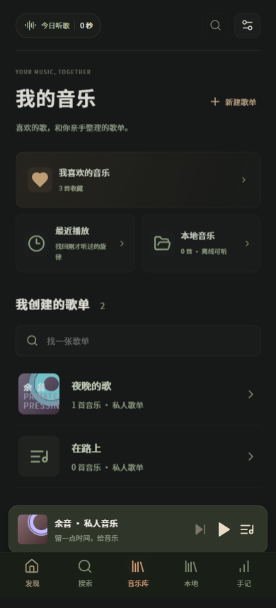
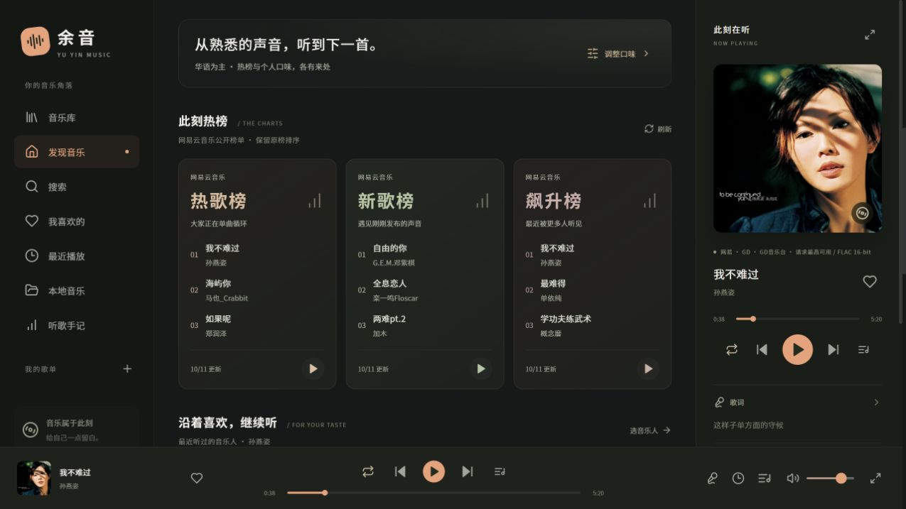

# 余音 · 私人音乐空间

给生活留一点回响。一个无广告的个人音乐 App，把发现、收藏、歌单和播放器放在安静的界面里。

**[下载最新 Android APK](https://github.com/junnhwan/yuyin-music/releases/latest)** · Android 7.0 及以上 · 在线音乐与本地播放

## 主要功能

- 发现音乐：网易榜单、常听歌手推荐与 Audius 独立音乐。
- 多来源搜索、歌手作品、搜索历史，保留歌手和录音版本信息。
- 独立音乐库：收藏、最近播放、个人歌单和本地音频。
- 播放队列、「下一首播放」、调整顺序、随机与循环；恢复上次歌曲和进度，启动保持暂停。
- 原生后台与锁屏播放、系统媒体控制、歌词跟随/导入和睡眠定时。
- 日/月/年听歌手记、本机资料备份与恢复、应用内检查更新。

## 界面预览

音乐库和播放器使用演示歌曲与歌单；桌面发现页来自 0.7.0 的真实联网验证。以下均为 Web 界面截图，Android 沿用同一套界面。

<table>
  <tr><th>我的音乐</th><th>播放器与歌词</th></tr>
  <tr>
    <td></td>
    <td></td>
  </tr>
</table>

## 安装与更新

从 Releases 下载正式 `.apk`，通过 Android 安装面板安装。应用设置支持检查更新、下载与校验，再交给系统安装。

后续正式版沿用相同包名和签名，直接覆盖安装，**不要先卸载**。升级前建议导出资料备份。此前 Debug 测试包与正式版签名不同，迁移前先备份。包名固定为 `cn.yuyin.music`。

## 音乐来源与本地资料

使用网易 · [GD音乐台](https://music.gdstudio.xyz)、酷我、咪咕与 Audius 等来源，部分歌曲由 [pdone/lx-music-source 收录的 Huibq 接口](https://github.com/pdone/lx-music-source)解析；歌词也使用 LRCLIB。GD 服务声明 CC BY-NC 4.0，仅供个人非商业使用。

在线播放需要手机能访问曲库、解析、音频与歌词服务，应用更新需要访问 GitHub；APK 不需要电脑在线。第三方服务可能缺歌、限流或失效，不保证所有作品、VIP 歌曲、无损音质或永久可用。请求档位与实际检测音质分别显示。

本地音频可离线播放，原文件需要保留。资料备份包含收藏、歌单、设置及听歌记录，**不包含音频文件**；换设备后需要重新导入本地音频。在线播放不主动下载整首音频，目前没有账号或跨设备同步。

已开展浏览器与 Android 模拟器验证；真机长时间锁屏、厂商省电限制、耳机与来电行为仍需体验反馈。此公开仓库分发 APK、校验文件、更新信息、介绍与截图，源码保存在私有仓库。
