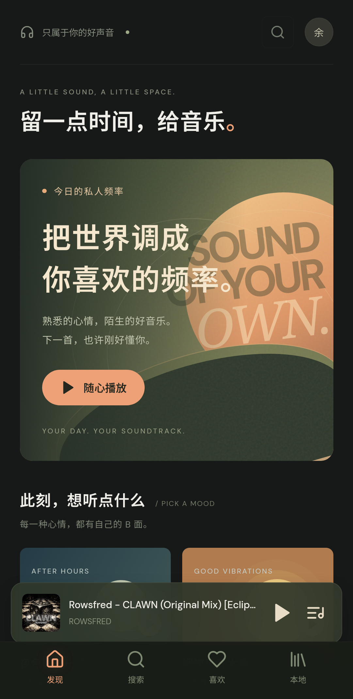
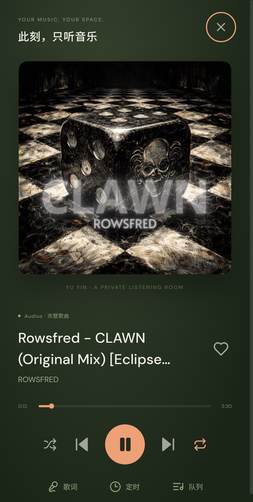

# 余音 · 私人音乐空间

给生活留一点回响。一个无广告、以在线播放为主的自用 Android 音乐应用。

**[下载最新 APK](https://github.com/junnhwan/yuyin-music/releases/latest)** · Android 7.0 及以上

 

## 功能

- 酷我、咪咕、Audius 搜索；支持综合、按歌名、按歌手筛选，来源状态与继续加载。
- Huibq 免登录解析，支持部分平台 VIP 歌曲的完整在线播放。
- 播放/暂停、切歌、进度、随机、循环与队列。
- 收藏、个人歌单、最近播放、本地音频导入。
- 原生后台和锁屏播放、歌词匹配/导入、睡眠定时。
- 本机资料备份与恢复。
- 设置中检查更新、查看说明、下载与校验、交给系统安装。

## 安装与更新

在 Releases 下载 `.apk`，通过 Android 的安装面板安装。首次安装时可能需要允许浏览器/文件管理器安装应用。

应用中点击头像打开设置，找到「应用更新」并「检查更新」。发现新版本后可下载并安装；也可以从发布页手动下载。后续正式版保持相同包名和签名，可覆盖安装保留收藏、歌单与设置，无需先卸载。

如果已经安装过此前本地 debug 测试包，请先在设置中导出资料备份，再迁移到正式版；测试包与正式版签名不同。备份包含音乐资料，不包含音频文件。

## 曲库与网络

v0.2.0 新增酷我、咪咕曲库搜索，与 Audius 汇总。咪咕优先请求公开完整音频，其他版本尝试 pdone/lx-music-source 收录的 Huibq 解析接口，无需音乐账号或自建服务器。已验证艾志恒Asen《在雨后醒来》、卓文萱《读心术》、周杰伦《晴天》的原唱播放与末段续播。

v0.2.1 修复 Asen 等歌手被相似英文名字淹没的排序问题，新增按歌手筛选（包含合作作品），修复咪咕分页。每个来源显示本页匹配数量或连接失败；VPN 节点和地区可能影响第三方请求，只有 Audius 返回结果时会提示。按歌手筛选基于平台返回歌曲，不代表完整歌手专页。

搜索结果保留歌手、版本与来源，不用翻唱替代原唱，并检测明显短于歌曲资料的试听片段。第三方服务可能缺歌、限流或失效，不保证所有 VIP 歌曲、无损音质或永久可用。歌词来自 LRCLIB，也可自行导入歌词。

需手机网络能访问曲库、解析、音频 CDN、歌词服务和 GitHub。APK 独立运行，不需要电脑在线。在线播放不主动保存整首音频；系统网络缓冲可能占用一定空间。本地音频通过文件引用播放，原文件需要保留。

已进行浏览器与 Android 模拟器测试；实际手机、厂商省电限制和长时间续播仍需体验反馈。

此公开仓库用于发布 APK、SHA-256 校验文件、更新信息和使用说明。源码保存在所有者的私有仓库，签名密钥不会公开。
